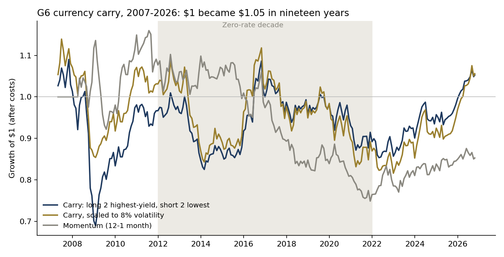
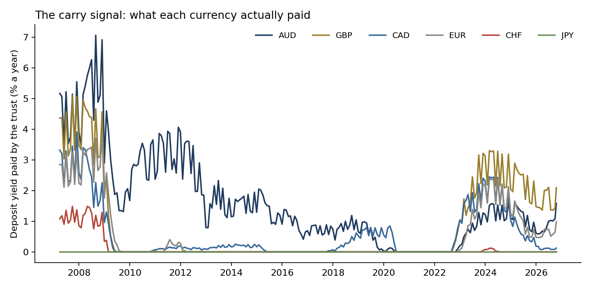
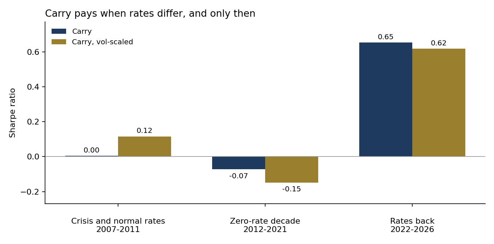
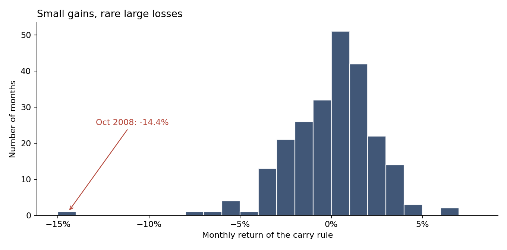

# FX carry on currencies an investor can actually hold, 2007–2026

**Question.** Borrowing in low-yield currencies to hold high-yield ones is one of the oldest premia in macro. What has a simple G6 carry book actually earned after costs, when does it pay, what does the crash cost, and how should a committee size it?

**Answer, on real data.** Holding the two highest-yielding and shorting the two lowest-yielding of six currencies (AUD, GBP, CAD, EUR, CHF, JPY against the US dollar), rebalanced monthly through the currency trusts that pass deposit interest through, earned 0.6% a year from April 2007 to October 2026 with a Sharpe ratio of 0.07. One dollar fell to $0.69 by January 2009 and was worth $1.05 at the end: five cents of profit in nineteen and a half years, after a 37% drawdown. October 2008 alone cost 14.4%. The premium depends on there being rates to harvest: Sharpe 0.00 in 2007–2011 (crash included), −0.07 in the zero-rate decade 2012–2021, and 0.65 since 2022. Scaling the book to 8% volatility kept the return and roughly halved the crash: October 2008 −7.5% instead of −14.4%, maximum drawdown −28% instead of −37%.

Full write-up: https://www.guptagaurav.info/articles/fx-carry-five-cents-in-nineteen-years

## Results

| Rule, Apr 2007 – Oct 2026 (235 months) | Return / yr | Volatility | Sharpe | Max drawdown | Worst month |
|---|---|---|---|---|---|
| A. Carry: long top 2 yields, short bottom 2 | 0.62% | 8.4% | 0.07 | −36.7% | −14.4% (Oct 2008) |
| B. A, only when the yield spread ≥ 1 point | 0.64% | 7.1% | 0.09 | −36.7% | −14.4% (Oct 2008) |
| C. A, scaled to 8% volatility (trailing 63 days) | 0.63% | 8.4% | 0.08 | −28.4% | −7.6% (Nov 2016) |
| D. Momentum (12-1 month), same structure | −0.56% | 7.2% | −0.08 | −35.4% | −7.9% |
| E. Long all six vs USD (short-dollar basket) | 0.13% | 7.5% | 0.02 | −34.8% | −6.8% (Oct 2008) |

Returns after 10 bp per unit of turnover. Total returns of the trusts include deposit interest and are net of their fees.

| Era | Average yield spread, top vs bottom | Carry Sharpe | Vol-scaled carry Sharpe |
|---|---|---|---|
| 2007–2011 (crisis and normal rates) | 3.6 points | 0.00 | 0.12 |
| 2012–2021 (zero-rate decade) | 1.1 points | −0.07 | −0.15 |
| 2022–2026 (rates back) | 1.8 points | 0.65 | 0.62 |

In the S&P 500's worst 10% of months, the carry book lost 0.9% on average (S&P −8.0%); the short-dollar basket lost 2.0%. Carry is not a hedge.

Illustrative committee sizing: a 1% of NAV volatility budget on a $1bn portfolio is about $118M of gross currency exposure, expected to earn about $0.7M a year on the full-sample average. Replaying October 2008 at that size: −$17.1M for the constant book, −$8.9M for the vol-scaled book.






## Method

- **Instruments.** Invesco CurrencyShares trusts (FXA, FXB, FXC, FXE, FXF, FXY). Each holds deposits in one currency and distributes the interest monthly, so the trust's total return is the currency's move against the dollar plus the deposit rate it actually earned, net of fees: carry an investor could hold, not a theoretical forward premium.
- **Carry signal.** At each month-end, the distributions with ex-dates in the previous 91 days, annualised, divided by the price. Only information dated on or before the month-end is used.
- **Rules** (fixed before results were examined; `configs/default.yaml`): A. long the two highest yields, short the two lowest, equal weight, dollar neutral; ties broken by currency code. B. A, but flat unless the top-to-bottom yield spread is at least one point. C. A, scaled each month to 8% annualised volatility using the trailing 63 trading days of the current book (cap 2×). D. 12-1 month momentum with the same structure. E. Long all six against the dollar.
- **Costs.** 10 bp per unit of turnover (illustrative). Borrowing costs of the short legs are not modelled beyond the trusts' own economics.
- **Data check.** Monthly trust returns are compared with the exchange rate itself (Yahoo quotes as currency per USD, inverted): correlations 0.95–0.98. Daily correlations are lower because the trust and the rate close at different times of day.

## Limits

- Six currencies is a narrow cross-section; institutional carry books use 10–30 currencies and forwards, with emerging markets where the carry is larger.
- The trusts' deposit rates sit below interbank and policy rates and were zero for several currencies for years. The ranking is close to the forward-implied carry, but the levels are lower.
- In the zero-rate decade several yields were exactly zero and the ranking was decided by tie-breaks; rule B exists to show what happens when the book only trades when there is something to rank.
- The last return month is partial (through 19 October 2026). Monthly rebalancing; no intramonth stops; no margin model.
- Independent research on public data; not investment advice and not deployed.

## Data and citations

Data
- Currency-trust and SPY daily closes and distribution events, Yahoo Finance. Copy used: [huggingface.co/datasets/defeatbeta/yahoo-finance-data](https://huggingface.co/datasets/defeatbeta/yahoo-finance-data) (ODC-BY). Files pinned by sha256 in `configs/default.yaml`.
- Daily exchange rates (Yahoo Finance), same dataset, `exchange_rate.parquet`, used only for the data check.

Methods referenced
- Brunnermeier, M., Nagel, S. and Pedersen, L. (2008). "Carry Trades and Currency Crashes." *NBER Macroeconomics Annual* 23, 313–347. [nber.org/papers/w14473](https://www.nber.org/papers/w14473)
- Lustig, H., Roussanov, N. and Verdelhan, A. (2011). "Common Risk Factors in Currency Markets." *The Review of Financial Studies* 24(11), 3731–3777.
- Menkhoff, L., Sarno, L., Schmeling, M. and Schrimpf, A. (2012). "Carry Trades and Global Foreign Exchange Volatility." *The Journal of Finance* 67(2), 681–718.
- Moreira, A. and Muir, T. (2017). "Volatility-Managed Portfolios." *The Journal of Finance* 72(4), 1611–1644.

All code, charts and text are the author's own.

## Run it

```bash
pip install -r requirements.txt
make all     # downloads the pinned files, verifies sha256, runs the pipeline
make test
```

Outputs: `reports/metrics.json`, `reports/monthly_returns.csv`, `reports/figures/`. Architecture: [docs/ARCHITECTURE.md](docs/ARCHITECTURE.md).

*Independent research on public data. Not investment advice. Dollar figures are illustrative.*
